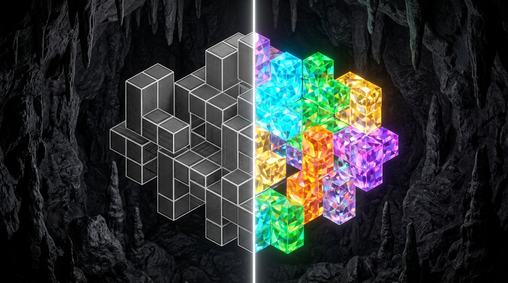
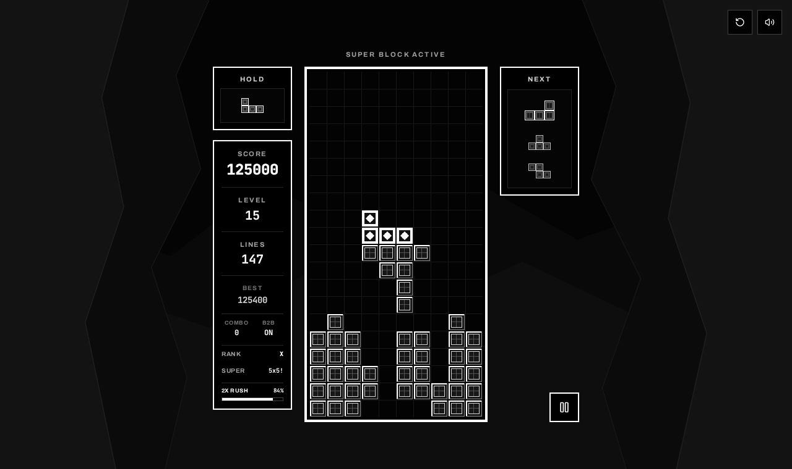
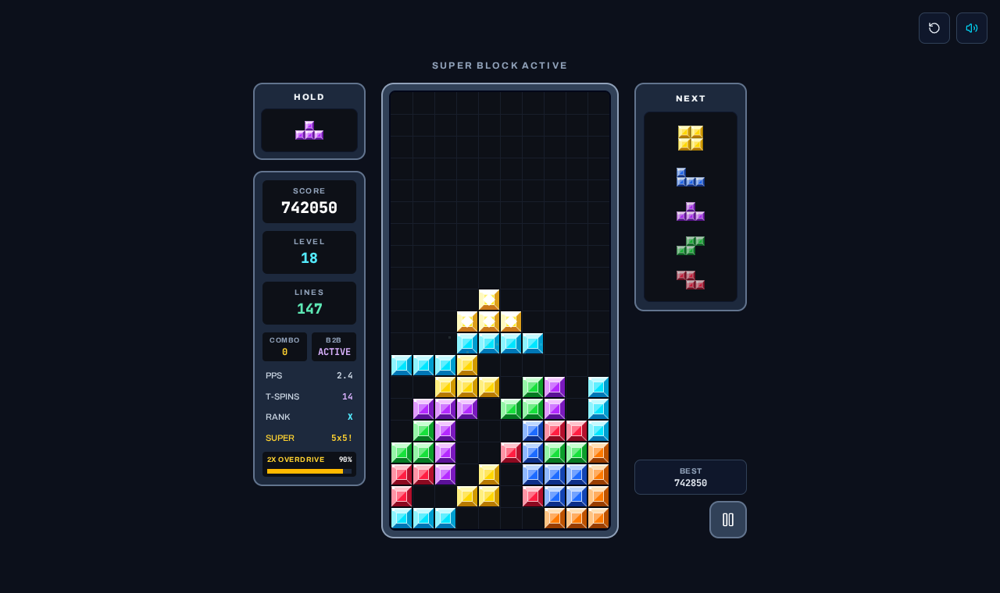
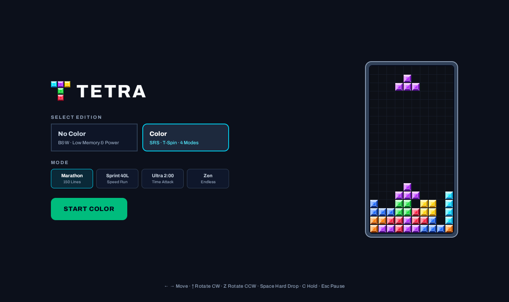
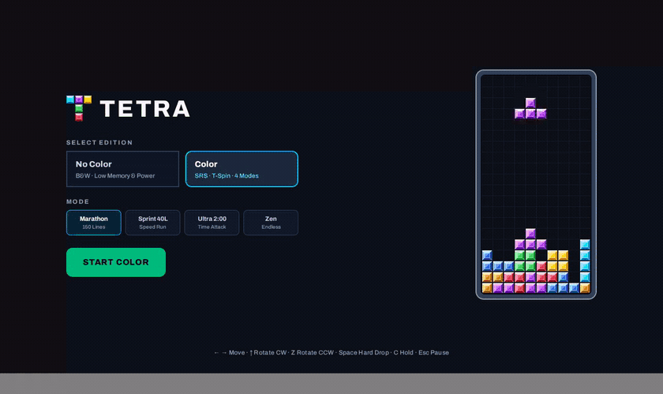

# TETRA — No Color & Color Editions



> **Created by:** **Md Shabbir Mia** ([shabbirmia520@gmail.com](mailto:shabbirmia520@gmail.com))  
> **License:** [MIT License](./LICENSE)

**TETRA** is an original, high-efficiency falling-block puzzle suite written in strict **TypeScript** with **TypedArrays**, **Canvas 2D**, and **procedural Web Audio**. It ships as **two individual, standalone game engines and folders**—one minimalist white-and-black engine engineered for minimal RAM and battery draw, and one full-color competitive engine packing 3D cut-diamond visuals, fiery blast sparks, Overdrive `2×` Rush, and four distinct game modes.

---

## Visual Showcase

| **No Color Edition (`no-color/`)** | **Color Advanced Edition (`color/`)** |
| :---: | :---: |
|  |  |
| *44-byte bitboard · Architectural wireframe · Static cave backdrop · Overdrive 2× & Super Blast* | *3D Cut Diamond facets · Exact `#00E5FF`–`#FF7A00` gems · T-Spins · Fire Sparks · 4 Modes* |

| **Title Screen & Live Edition Switch** |
| :---: |
|  |
| *Bespoke 3D diamond emblem · Edition switcher · Marathon / Sprint 40L / Ultra 2:00 / Zen* |

---

## Gameplay Video Demo

Watch both **Color Advanced Edition** (3D cut diamonds, Overdrive `2×` Rush, and Solar `5×5` Blast shockwave with fiery sparks) and **No Color Edition** (static rocky cave backdrop, architectural wireframe blocks, and monochrome `5×5` shockwave blast) running live:



- **HD Video (MP4 · 1280×760 · 25 fps):** [`src/assets/demo/tetra_gameplay_demo.mp4`](src/assets/demo/tetra_gameplay_demo.mp4)

---

## Two Individual Game Folders

### 1. `no-color/` — White & Black Edition (`no-color/engine.ts` + `no-color/NoColorGame.tsx`)
Engineered from the ground up for ultra-low memory consumption, minimal battery/CPU draw, and stark monochrome clarity:
- **44-Byte Row Bitboard (`Uint16Array(22)`)**: Each row of the 10×22 matrix is stored as a single 16-bit integer (bits `0..9`), enabling O(1) bitwise collision checks and instant full-row detection (`row === 0x3FF`).
- **Packed 4×4 Piece Masks & Flat Kick Tables**: All 28 piece rotation states reside in a 56-byte `Uint16Array`, while SRS + 180° wall kicks reside in flat `Int8Array` lookup tables.
- **Event-Driven Low-Power & 1995-Hardware Ready**:
  - Pre-bakes `28×28` architectural monochrome wireframe, Super crosshair, and dashed ghost sprites plus a static matrix grid onto offscreen canvases once so every frame uses pure integer `drawImage()` blits.
  - Frames the monochrome playfield with a static layered rocky cave & hill cliff backdrop (zero runtime CPU/animation overhead).
  - Computes the exact millisecond delay until the next gravity step, lock timer, or callout expiry via `getNextWakeDelayMs()`, sleeping with `setTimeout` instead of spinning a 60 Hz `requestAnimationFrame` loop while idle, waking briefly only during active sparks/flashes and dropping to **0% CPU** when paused or on Game Over.
- **Complete Classic & Modern Ruleset + Super Block, Overdrive & Clutch Save**: 7-bag randomizer (`Uint8Array`), Hold piece (with `holdIsSuper` preservation), 3-piece Next queue, dashed Ghost piece, SRS + 180° rotation (`A`), Back-to-Back Quads (1.5×), Combo chains with rising musical scale tones, All Clear bonuses, **Clutch Save** (`+250 × level` when clearing near top danger rows), **Overdrive `2×` Score Rush** (fills `feverCharge 0–100%` for a 12 s `2×` multiplier), **Rank (`D → C → B → A → S → SS → X`)**, **Super Block Rewards** (`X/8` line tracker, B2B Quad, or All Clear) detonating a **5×5 Shockwave Blast** (`+100 × cells + 250 × level`), monochrome laser-beam/starburst line-clear FX, and a 48-spark `Float32Array` burst pool.

### 2. `color/` — Advanced Modern Color Edition (`color/engine.ts` + `color/ColorGame.tsx`)
Built for high-speed competitive play, crisp 3D diamond visuals, fiery impact FX, and retro-class CPU efficiency:
- **240-Byte Compact Matrix (`Uint8Array(240)`)**: Stores the 10×24 playfield (rows `0..3` spawn buffer + rows `4..23` visible matrix) using 1 byte per cell.
- **Pre-Baked `224×28` 3D Cut-Diamond Sprite Atlases**: Pre-renders all 7 jewel blocks (`#00E5FF` Cyan, `#FFD600` Gold, `#B429FF` Amethyst, `#18E03C` Emerald, `#FF1E42` Ruby, `#1D6BFF` Sapphire, `#FF7A00` Tangerine) plus Slot 8 (`#FFE600` Solar Super Diamond) with 4-way pyramidal cut bevels, diagonal corner ribs, center jewel table, specular crystal glints, and ghost outlines once at startup.
- **Zero-GC Fire-Spark & Starburst FX (`Float32Array(72 × 7)`)**: Fixed 2,016-byte ring buffer drives streaking fiery white-gold-orange embers (`colorId === 0`) and crystal shards alongside horizontal laser-beam sweeps, radial starburst flares, shockwave rings, 45–55 ms hitstop, and decaying `trauma²` camera shake.
- **Super Diamond 5×5 Blast, Overdrive `2×` Rush, Clutch Save & Live Rank**: Clearing lines charges Overdrive (`0–100%` → 12 s **`2×` Score Rush**), top-danger clears award **Clutch Save** (`+250 × level`), live performance grades from **`D → X`**, and hitting a B2B difficult clear, All Clear, or every **8 lines (`X/8`)** rewards a Solar Super Diamond (`holdIsSuper` preserved on Hold swaps) that triggers a 5×5 Blast on impact.
- **Adaptive Low-Power Scheduler & Flat Hardware UI**: Uses an opaque `{ alpha: false }` canvas, blits the cached offscreen matrix grid, eliminates CSS blur shadows and multi-stop gradients for software rasterizers, and exits 60 FPS `requestAnimationFrame` into event-driven `getNextWakeDelayMs()` sleep whenever particles/shake settle and no movement keys are held.
- **Full Super Rotation System (SRS) + 180°**: Complete CW, CCW, and 180° rotation with JLSTZ, I, and 180° kick tables.
- **T-Spin & Mini T-Spin Detection**: Implements the 3-corner T-slot rule around the T-piece center with front-corner + 5th kick verification (`T-Spin Zero`, `Mini`, `Single`, `Double`, `Triple`).
- **Back-to-Back (B2B), Combo (Ren) & All Clear**: 1.5× multiplier on consecutive Quads or T-Spin line clears, escalating `50 × combo × level` chains with rising semitone Web Audio feedback, and Perfect Clear bonuses (`+1800` / `+3200 × level`).
- **4 Distinct Game Modes**:
  - **Marathon** — Classic climb through accelerating gravity curves toward 150 lines (Start Level `1–15`).
  - **Sprint 40L** — Clear 40 lines as fast as possible with live **PPS** (Pieces Per Second) and elapsed timer.
  - **Ultra 2:00** — Score attack under a strict 2-minute countdown clock.
  - **Zen** — Relaxed endless mode with gentle constant gravity.
- **Competitive Handling Tuning**: Real-time **DAS** (`70–220 ms`), **ARR** (`0–60 ms`, including `0 ms` instant slide), and **SDF** (`4×–40×`) sliders inside Options, plus 5-piece Next queue, Hold slot, 500 ms Lock Delay (15-reset cap), and original procedural Web Audio synthesis (`src/audio/synth.ts`).

---

## Complete Technical Specifications

### Memory Architecture

| Subsystem | `no-color/` Edition | `color/` Edition | Notes |
| :--- | :--- | :--- | :--- |
| **Playfield Matrix** | `Uint16Array(22)` — **44 bytes** | `Uint8Array(240)` — **240 bytes** | 10×22 bitboard vs. 10×24 per-cell color IDs |
| **7-Bag Buffers** | `Uint8Array(14)` — **14 bytes** | `Uint8Array(14)` — **14 bytes** | Dual pre-allocated Fisher–Yates bags (zero GC) |
| **Piece Bitmasks** | `Uint16Array(28)` — **56 bytes** | `Uint16Array(28)` — **56 bytes** | 4×4 rotation masks packed into 16 bits |
| **Clearing Row Flags** | Bitwise `number` register | `Uint8Array(24)` — **24 bytes** | Row-clear flash tracking |
| **Particle Ring Pool** | `Float32Array(48 × 5)` UI FX (0B engine) | `Float32Array(72 × 7)` — **2,016 bytes** | Fixed circular buffer, zero heap churn |
| **Canvas Backbuffer** | `{ alpha: false }` + Offscreen Grid Cache | `{ alpha: false }` + Offscreen Grid Cache | Single `drawImage()` grid blit + dirty check |

### Scoring & Multiplier Specification

| Action | Base Points (`× Level`) | Back-to-Back Eligible |
| :--- | :--- | :--- |
| **Soft Drop / Hard Drop** | `1 pt / cell` · `2 pts / cell` | No |
| **Single / Double / Triple** | `100` · `300` · `500` | Resets B2B |
| **Quad (4-Line Clear)** | `800` | Yes (`1.5×` = `1,200`) + Super Charge |
| **Mini T-Spin (0 / 1 Line)** *(Color)* | `100` · `200` | Yes on line clear (`1.5×`) + Super Charge |
| **T-Spin (0 / 1 / 2 / 3 Lines)** *(Color)* | `400` · `800` · `1,200` · `1,600` | Yes on line clear (`1.5×`) + Super Charge |
| **Super Block 5×5 Blast** | `+100 × blasted cells + 250` | Earned on B2B difficult clear / All Clear / every 8 lines |
| **Clutch Save** | `+250` | Stacks on line clears when top danger rows are occupied |
| **Overdrive `2×` Rush** | **`2×` Total Clear Score** | 12 s surge once `feverCharge` hits `100%` (extends on clears) |
| **Combo Chain (Ren)** | `+50 × combo × level` | Stacks with B2B & Overdrive |
| **All Clear (Perfect Clear)** | `+1,800` (1–3L) / `+3,200` (Quad) | Stacks with B2B, Combo & Overdrive + Super Charge |

### Gravity, Lock Delay & Handling Specs
- **Gravity Curve**: `interval(level) = max(0.015s, (0.8 - (L - 1) × 0.007)^(L - 1))` where `L = min(19, level - 1)` (constant `0.9s` in Zen mode).
- **Lock Delay**: `500 ms` grounded grace period with up to **15 movement/rotation resets** before forced lock.
- **PRNG**: Deterministic 32-bit Xorshift (`rngState`) for reproducible seeded runs and unit tests.
- **Default Handling**: `DAS = 135 ms`, `ARR = 20 ms`, `SDF = 18×`, `Low Power Mode = ON`, `180° Rotate = ON`.

---

## Controls

| Action | Keyboard | Mobile / Touch |
| :--- | :--- | :--- |
| Move Left / Right | `←` / `→` | On-screen `←` / `→` |
| Soft Drop | `↓` | On-screen `↓` |
| Hard Drop | `Space` | On-screen `DROP` |
| Rotate Clockwise | `↑` or `X` | On-screen `↻` |
| Rotate Counter-Clockwise | `Z` or `Ctrl` | — |
| Rotate 180° | `A` | — |
| Hold Piece | `C` or `Shift` | On-screen `HOLD` |
| Pause / Options / How to Play | `Esc` or `P` | Bottom-right `Pause` |
| Quick Restart | `R` | Top-right `Restart` |

---

## Project Structure

```text
├── no-color/                        # Standalone White & Black falling-block folder
│   ├── engine.ts                    # 44-byte bitboard engine & wake scheduler
│   ├── engine.test.ts               # Unit tests (node:test)
│   └── NoColorGame.tsx              # Monochrome Canvas2D renderer & low-power loop
├── color/                           # Standalone Color Advanced Modern folder
│   ├── engine.ts                    # Advanced SRS / T-Spin / B2B / Particle pool engine
│   ├── engine.test.ts               # Unit tests (node:test)
│   └── ColorGame.tsx                # Faceted jewel Canvas2D renderer & adaptive loop
├── src/
│   ├── assets/
│   │   ├── demo/                    # Gameplay demo recordings (MP4 & animated GIF)
│   │   └── images/                  # README hero banner & live edition showcase PNGs
│   ├── audio/
│   │   └── synth.ts                 # Original procedural Web Audio API synthesizer
│   ├── components/
│   │   ├── Modals.tsx               # Pause, Options, How to Play, Victory/Game Over modals
│   │   ├── PiecePreview.tsx         # Lightweight SVG Hold/Next piece preview
│   │   └── TitleScreen.tsx          # Title stage with live centerpiece & edition switch
│   ├── types/
│   │   └── game.ts                  # Shared shell & options types
│   └── App.tsx                      # Full-viewport Game Shell state machine
├── LICENSE                          # Full MIT License (Md Shabbir Mia)
└── README.md                        # Complete documentation & specifications
```

---

## Development & Verification

```bash
# Install dependencies
npm install

# Start development server (port 3000)
npm run dev

# Run deterministic unit tests for both engines
npm test

# Type-check and production build
npm run lint
npm run build
```

---

## Author & Contact

- **Author:** Md Shabbir Mia
- **Email:** [shabbirmia520@gmail.com](mailto:shabbirmia520@gmail.com)

## Legal & Independence Notice

- **Original Open-Source Code**: All game logic, TypedArray engines, Canvas 2D rendering, UI components, and procedural Web Audio synthesizer tones in this repository are original implementations created by Md Shabbir Mia.
- **No Third-Party Trademarks or Copyrighted Assets**: **TETRA** is an independent, non-commercial open-source falling-block puzzle project. It is not affiliated with, endorsed by, or sponsored by any third-party brand or rights holder, and contains no external audio files, copyrighted sprites, or proprietary assets.

## License

Licensed under the **MIT License**. See the complete [`LICENSE`](./LICENSE) file for full terms and conditions.
